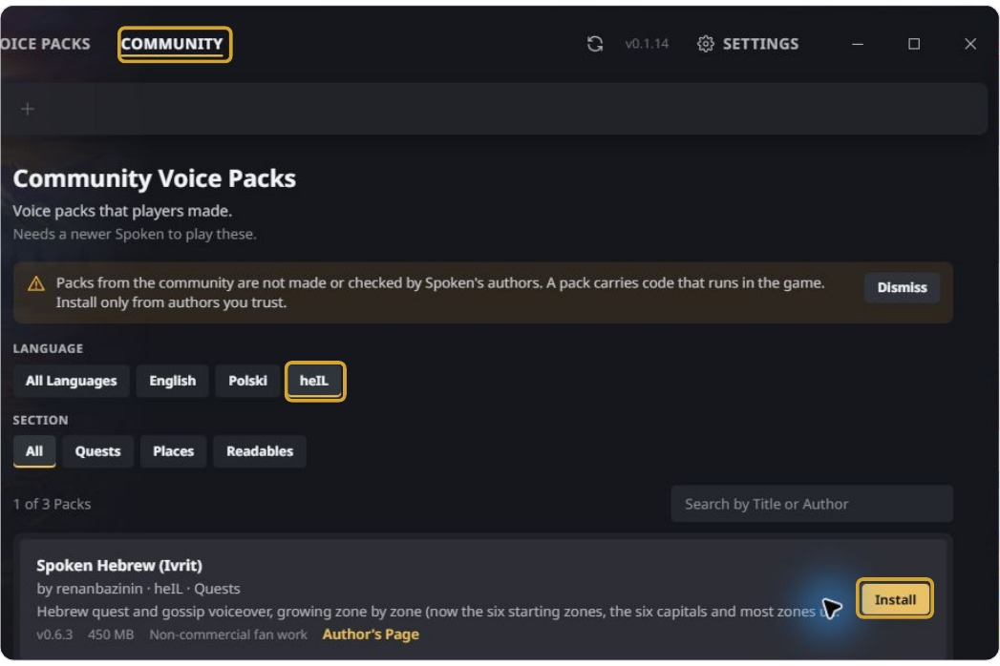
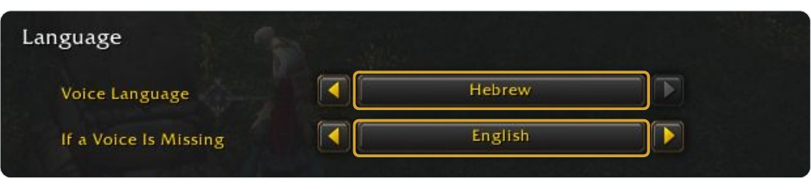
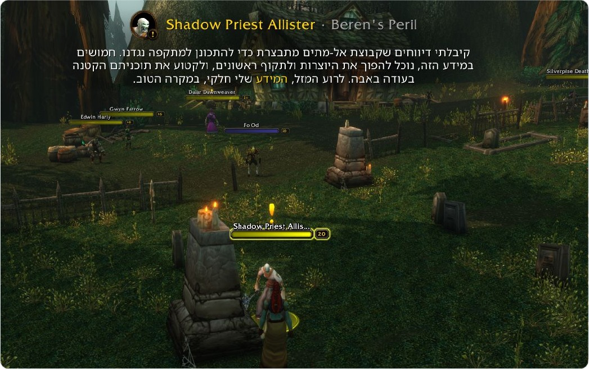

<div dir="rtl" lang="he">

# WoW בעברית - מדריך התקנה מצולם

**Spoken** הוא התוסף, ו-**Spoken Hebrew (Ivrit)** היא חבילת הדיבוב בעברית שמוסיפים אליו.

**צריך:** WoW Forever ותוסף Spoken בגרסה **3.9.0 ומעלה**.

בוחרים אחת משתי אפשרויות ההתקנה:

- [אפשרות 1: הכול דרך Spoken Manager](#manager)
- [אפשרות 2: CurseForge והוספת חבילת העברית ידנית](#curseforge)

אחרי ההתקנה ממשיכים אל [בחירת העברית במשחק](#in-game).

---

<a id="manager"></a>

## אפשרות 1: Spoken Manager

המנהל מתקין ומעדכן את Spoken ואת חבילת העברית.

### 1. מורידים ומתקינים את המנהל

פותחים את [אתר Spoken](https://spoken.quest/#install), בוחרים **Windows (.exe)** ומתקינים.

### 2. מתקינים או מעדכנים את Spoken

פותחים את המנהל, בוחרים **WoW: Forever**, ובכרטיסיית **Spoken** מתקינים או מעדכנים את התוסף לגרסה **3.9.0 ומעלה**.

### 3. מוסיפים את חבילת העברית

פותחים **Community**, בוחרים **heIL**, ולוחצים **Install** ליד **Spoken Hebrew (Ivrit)**.



ממתינים לסיום ההורדה וההתקנה, עד שמופיע **Installed**.

**ההתקנה הושלמה? ממשיכים אל [בחירת העברית במשחק](#in-game).**

---

<a id="curseforge"></a>

## אפשרות 2: CurseForge והוספת העברית ידנית

את Spoken מתקינים דרך CurseForge, ואת חבילת העברית מוסיפים מקובץ ZIP.

### 1. מתקינים או מעדכנים את Spoken

ב-CurseForge בוחרים **WoW: Forever** ומתקינים את [Spoken](https://www.curseforge.com/wow/addons/spoken) בגרסה **3.9.0 ומעלה**.

### 2. מורידים את חבילת העברית

פותחים את [עמוד ההורדות של חבילת העברית](https://github.com/renanbazinin/spoken-ivrit/releases), ובוחרים תחת **Assets** את קובץ ה-ZIP ששמו מתחיל ב-**SpokenCommunity_ivrit**.

לדוגמה: `SpokenCommunity_ivrit-0.6.3.zip`. קובצי **Source code** הם קוד הפרויקט, ולא חבילת הדיבוב להתקנה.

### 3. מחלצים לתיקיית AddOns של המשחק

מחפשים את תיקיית ההתקנה של WoW Forever ומחלצים את תיקיית **SpokenCommunity_ivrit** לתוך:

</div>

```text
World of Warcraft\_forever_\Interface\AddOns
```

<div dir="rtl" lang="he">

אחרי החילוץ, מבנה התיקיות צריך להיראות כך:

</div>

```text
World of Warcraft
└── _forever_
    └── Interface
        └── AddOns
            └── SpokenCommunity_ivrit
                ├── SpokenCommunity_ivrit.toc
                └── ...
```

<div dir="rtl" lang="he">

**ההתקנה הושלמה? ממשיכים לבחירת העברית במשחק.**

---

<a id="in-game"></a>

## עכשיו בוחרים עברית במשחק

השלבים הבאים זהים בשתי אפשרויות ההתקנה.

### 1. מפעילים את המשחק מחדש ופותחים הגדרות

כותבים בצ׳אט את הפקודה הבאה ולוחצים **Enter**:

</div>

```text
/sp options
```

<div dir="rtl" lang="he">

אפשר גם ללחוץ על סמל Spoken שליד המפה הקטנה.

גוללים אל **Language** ובוחרים:

- **Voice Language:** ‏**Hebrew**
- **If a Voice Is Missing:** ‏**English**, כשפת גיבוי למשימות שעוד לא הוקלטו בעברית.



### 2. מדברים עם נותן משימות ופותחים משימה

במשימות שהוקלטו בעברית, הדיבוב והכתוביות יהיו בעברית.



חלון המשימה המקורי נשאר באנגלית; הכתוביות של Spoken בעברית.

---

### משהו לא עובד?

- **אין Hebrew ברשימת השפות:** מוודאים שהחבילה מותקנת, מעדכנים את Spoken לגרסה 3.9.0 ומעלה ומפעילים את המשחק מחדש.
- **שומעים אנגלית:** בוחרים Hebrew במפורש. האפשרות Auto עוקבת אחרי שפת המשחק ואינה בוחרת עברית; ייתכן גם שהמשימה עדיין לא הוקלטה בעברית.
- **משפט נשמע לא טוב:** [אפשר לדווח כאן](https://github.com/renanbazinin/spoken-ivrit/issues/new/choose).

הצילומים נעשו בהתקנה ובמשחק בפועל ב-14.11.2026, עם Spoken Manager ‏0.1.14, ‏Spoken ‏3.9.0 וחבילת עברית ‏0.6.3.

פרויקט מעריצים לא מסחרי, לא רשמי של Blizzard. הקולות נוצרו באמצעות ElevenLabs.

</div>
